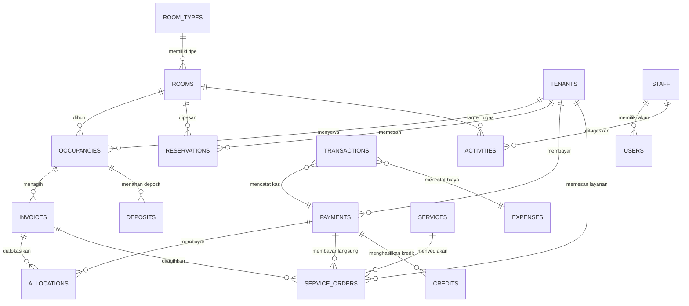

# Arsitektur Sistem

## Ringkasan

Aplikasi terdiri dari tiga lapisan:

1. **Server Node.js** pada `server.js` yang melayani berkas statis dan REST API.
2. **Layanan domain** pada `src/services/` yang memegang seluruh aturan bisnis dan perhitungan keuangan.
3. **Klien SPA** pada `public/` yang menampilkan data, formulir, cetak dokumen, dan ekspor CSV.

Server adalah satu-satunya sumber kebenaran. Klien tidak pernah menghitung saldo invoice, alokasi pembayaran, atau kewajiban deposit secara final. Setiap mutasi melewati validasi, guard izin, audit, dan lock penulisan.

## Komponen server

| Berkas | Tanggung jawab |
| --- | --- |
| `server.js` | HTTP server, static serving, security header, bootstrap, scheduler |
| `src/api.js` | Routing endpoint, parsing body, guard sesi, pemanggilan layanan |
| `src/auth.js` | Login, cookie sesi, matriks izin per peran |
| `src/db.js` | Pemilih backend JSON/Postgres, cache, antrean penulisan `withLock` |
| `src/pg/schema.js` | Pemetaan koleksi aplikasi ke tabel dan primary key |
| `src/pg/store.js` | Snapshot Postgres, diff baris, transaksi, advisory lock |
| `src/pg/driver.js` | Pool `pg` dan konfigurasi SSL |
| `src/bootstrap.js` | Inisialisasi basis data, seeding demo, rekonsiliasi awal |
| `src/jobs.js` | Tagihan harian, overdue, backup, scheduler 6 jam |
| `src/seed.js` | Skema dan data contoh |
| `src/util.js` | Tanggal, validasi, ID, jumlah uang, enum |

## Mode Postgres

`src/services/*.js` tetap sinkron karena dipakai juga oleh bundel Apps Script. Saat `SUPABASE_DB_URL` diisi, `src/db.js` membuat store Postgres:

1. satu query `jsonb_build_object` memuat seluruh tabel ke snapshot kecil di memori;
2. setiap request membandingkan `id_counters.__data_version`;
3. setiap mutasi berjalan dalam transaksi dengan `pg_advisory_xact_lock`, memuat snapshot terbaru, menjalankan service yang sama, lalu menyimpan diff baris dan counter.

Perubahan langsung di luar API tidak menaikkan versi cache; semua penulisan harus melalui API. Detail operasional ada di `docs/supabase/README.md`.

## Modul domain

| Modul | Fungsi |
| --- | --- |
| `rooms.js` | Kamar, tipe kamar, ketersediaan, konflik kapasitas |
| `tenants.js` | Penghuni dan kartu akun penghuni |
| `occupancy.js` | Reservasi, check-in, transfer, perpanjangan, check-out |
| `billing.js` | Invoice bulanan, prorata, overdue, pembatalan, penyesuaian |
| `payments.js` | Pembayaran, alokasi, kredit, kuitansi, void, ledger |
| `serviceOrders.js` | Master layanan dan order layanan |
| `expenses.js` | Pengeluaran, persetujuan, pembayaran, pembatalan |
| `deposits.js` | Kewajiban deposit dan pengembalian |
| `staff.js` | Data staf dan peran aplikasi |
| `users.js` | Akun login dan pengelolaan peran |
| `activities.js` | Tugas operasional dan update status |
| `masters.js` | Pengaturan, daftar harga, audit, log sistem |
| `reports.js` | Dashboard, laporan, rekonsiliasi, ringkasan pendapatan |
| `common.js` | Audit, helper setting, pencarian record |

## Model data



Koleksi utama pada `data/db.json`:

- master: `settings`, `roomTypes`, `rooms`, `tenants`, `priceList`, `services`, `staff`, `users`;
- operasional: `reservations`, `occupancies`, `invoices`, `payments`, `allocations`, `credits`, `serviceOrders`, `expenses`, `activities`;
- keuangan dan audit: `transactions`, `deposits`, `auditLog`, `systemLog`.

ID permanen menggunakan prefiks berurutan, misalnya `RM-0001`, `T-0001`, `OCC-0001`, `INV/YYYYMM/0001`, `PAY-0001`, `KWT/YYYYMM/0001`, `TXN-0001`. Baris atau indeks array tidak pernah menjadi referensi permanen.

## API

Semua endpoint berada di bawah `/api` dan mengembalikan bentuk:

```json
{ "ok": true, "data": {} }
```

Kesalahan mengembalikan:

```json
{ "ok": false, "error": "Pesan yang dapat dibaca", "code": "ERROR_CODE" }
```

Kelompok endpoint:

| Area | Endpoint |
| --- | --- |
| Autentikasi | `POST /auth/login`, `POST /auth/logout`, `GET /auth/me` |
| Bootstrap | `GET /bootstrap`, `GET /dashboard` |
| Kamar | `GET/POST /rooms`, `GET/POST /room-types` |
| Penghuni | `GET/POST /tenants` |
| Reservasi | `GET/POST /reservations`, `POST /reservations/:id` |
| Hunian | `GET /occupancies`, `POST /check-in`, `/transfers`, `/renew`, `/check-out` |
| Tagihan | `GET /invoices`, `POST /invoices/generate`, `GET /invoices/:id`, `POST /invoices/:id/cancel`, `POST /invoices/:id/adjust` |
| Pembayaran | `GET/POST /payments`, `GET /payments/:id`, `POST /payments/:id/void` |
| Layanan | `GET/POST /services`, `GET/POST /service-orders` |
| Pengeluaran | `GET/POST /expenses`, `POST /expenses/:id/cancel` |
| Kas dan deposit | `GET /transactions`, `GET /deposits`, `POST /deposits/return` |
| Staf dan akun | `GET/POST /staff`, `GET/POST /users` |
| Tugas | `GET/POST /activities`, `POST /activities/:id` |
| Master | `GET/POST /settings`, `GET/POST /price-list`, `GET /audit`, `GET /system/logs` |
| Laporan | `GET /reports/financial`, `/daily`, `/occupancy`, `/statement`, `/reconcile`, `/revenue` |
| Sistem | `POST /system/run-jobs`, `POST /system/backup` |

Parameter laporan menggunakan query string: `from`, `to`, `date`, `tenantId`, `status`.

## Keamanan dan sesi

- Password di-hash dengan `scrypt` dan salt acak.
- Sesi disimpan di memori server dengan cookie `HttpOnly`, `SameSite=Lax`, masa berlaku 7 hari.
- Sesi menyimpan fingerprint hash password. Perubahan password atau penonaktifan akun mencabut sesi lama pada request berikutnya.
- Login dibatasi per email dengan `LOGIN_MAX_ATTEMPTS` dan `LOGIN_WINDOW_MS` untuk mengurangi brute force.
- Setiap endpoint terlindungi memanggil `guard(user, module, action)`.
- Matriks izin berada di `src/auth.js` dan dapat diaudit terpisah dari UI.
- Output HTML klien di-escape melalui `UI.esc` sebelum disisipkan.
- Header keamanan diterapkan pada server: `X-Content-Type-Options`, `X-Frame-Options`, `Referrer-Policy`, dan pembatasan body request.
- Jejak audit mencatat perubahan master, keuangan, dan operasional penting.

## Integritas dan konkurensi

- `withLock` menyerialkan seluruh mutasi basis data.
- Pembayaran memakai `IdempotencyKey`; pengiriman ulang mengembalikan record yang sama.
- Invoice memiliki kunci unik berdasarkan hunian dan awal periode, sehingga proses harian aman dijalankan berulang.
- Saldo invoice selalu dihitung ulang dari total, pembayaran valid, dan kredit.
- Pembatalan dan void tidak menghapus record; dibuat jurnal pembalik dan status baru.
- Rekonsiliasi memeriksa konsistensi invoice, alokasi, kredit, deposit, dan ledger.

## Otomatisasi

`src/jobs.js` menjalankan:

- pembuatan invoice yang jatuh tempo;
- pembaruan status overdue;
- rekonsiliasi;
- audit otomatis.

Scheduler berjalan setiap 6 jam dan mencatat eksekusi harian. Administrator dapat menjalankan ulang melalui `POST /system/run-jobs` dari halaman Pengaturan atau Sistem.

Backup manual menghasilkan salinan JSON di `data/backups/`. Retensi dan prosedur pemulihan dijelaskan pada `docs/OPERATIONS.md`.

## Klien

- `public/js/api.js` membungkus `fetch`, menangani error, dan sesi berakhir.
- `public/js/ui.js` menyediakan tabel, pencarian, sortir, paginasi, modal, formulir, toast, kuitansi, cetak, dan ekspor CSV.
- `public/js/core.js` menyimpan pengguna, metadata, izin, dan navigasi.
- `public/js/pages/` berisi halaman per domain.
- `public/js/app.js` menangani login, bootstrap, router hash, navigasi per izin, dan logout.

Rute hash yang tersedia mencakup dashboard, rooms, room-types, tenants, reservations, agreements, invoices, payments, services, expenses, transactions, deposits, activities, staff, users, master-data, reports, dan settings.


## 13. Target Google Apps Script

`src/code.gs` adalah bundel mandiri untuk Google Apps Script. Bundel berisi:

- adapter database Google Sheets dengan tab per koleksi;
- autentikasi token melalui CacheService;
- password berbasis iterasi SHA-256 dengan salt;
- router API yang sama dengan versi Node.js;
- antarmuka SPA yang disisipkan langsung ke HTML output;
- trigger harian untuk tagihan, overdue, rekonsiliasi, dan backup Drive.

Bundel dibangun dari `src/gas/`, `src/services/`, `src/util.js`, `src/seed.js`, `src/bootstrap.js`, dan aset `public/` melalui `npm run build:gas`. Sumber Node.js tetap menjadi acuan logika bisnis.

Perbedaan runtime:

| Aspek | Node.js | Google Apps Script |
| --- | --- | --- |
| Database | `data/db.json` atau Supabase Postgres | Google Sheets |
| Sesi | Cookie dan memori proses | Token dan CacheService |
| Password | scrypt | iterasi SHA-256 |
| Penjadwalan | Timer proses | Trigger harian |
| Backup | Berkas lokal | Salinan Google Drive |
| Transport frontend | REST fetch | google.script.run |
